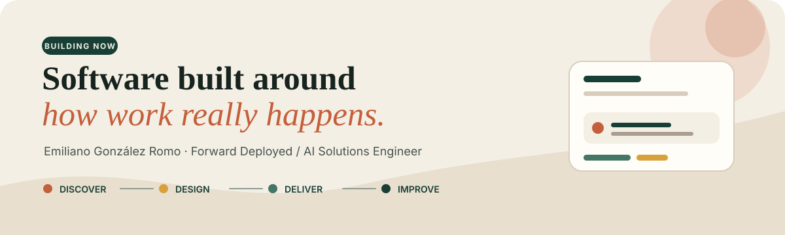
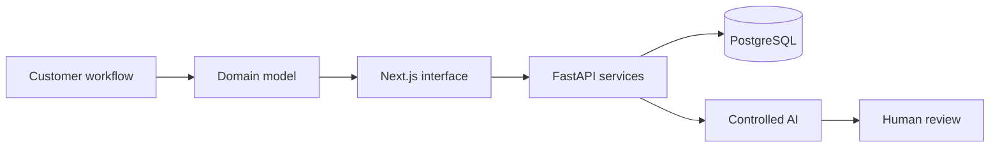

  

 

# Emiliano González Romo — Engineering Overview

  
  
  

## What this repository is

This is a concise index of my public engineering work. It is designed for recruiters, engineering leaders, and potential clients who want to understand how I move from an unclear customer problem to a deployed system.

My strongest work combines:

- direct customer and workflow discovery;
- full-stack product delivery;
- applied AI with explicit data and human-control boundaries;
- technical decisions connected to operational outcomes.

## Current direction

I am focused on **Forward Deployed Engineering**, **AI Solutions Engineering**, and customer-facing full-stack roles in LATAM.

Before building software products, I worked directly with real-estate clients and sales teams. That experience taught me to look beyond the initial request, model the real operation, and remain accountable after delivery.

## Oniria

**Founder · Software consulting and product development**

Oniria is my software company. It helps teams translate operational problems into maintainable digital products through discovery, workflow design, architecture, implementation, security, and delivery.

Its first product is **PropPilot**, a real-estate operations platform currently working inside Crestify and being prepared for additional companies.

## PropPilot

### The operating problem

Real-estate acquisition work was distributed across messages, calls, spreadsheets, incomplete property files, debt calculations, proposals, and individual memory.

### The product

PropPilot brings contacts, properties, acquisition cases, debts, offers, tasks, appointments, permissions, and controlled AI assistance into one operating workflow.

### My ownership

| Area | Work |
| --- | --- |
| Product | Discovery, requirements, prioritization, workflow design |
| Frontend | Next.js, React, TypeScript, responsive application flows |
| Backend | FastAPI, Pydantic, service and repository layers |
| Data | PostgreSQL, Supabase, SQLAlchemy 2.0, Alembic |
| Security | Authentication, JWT access, role-aware records, field boundaries |
| Applied AI | Structured extraction, contextual retrieval, allowlists, human confirmation |
| Delivery | Automated tests, Git, GitHub Actions, CI/CD, deployment |

### Engineering flow

[Open the product →](https://state-ai-frontend.vercel.app/)  
[Read the full case study →](https://github.com/h8hyf2rw9y-afk/StateAI-Overview)

## Selected public work

| Project | Context | Evidence |
| --- | --- | --- |
| Engineering Portfolio | Bilingual recruiter-facing web product | [Live site](https://h8hyf2rw9y-afk.github.io/Portfolio/) · [Repository](https://github.com/h8hyf2rw9y-afk/Portfolio) |
| PropPilot | Oniria product operating inside Crestify | [Live product](https://state-ai-frontend.vercel.app/) · [Case study](https://github.com/h8hyf2rw9y-afk/StateAI-Overview) |
| BabyDuck Compiler | Individual compiler implementation | [Repository](https://github.com/MasterZendika/BabyDuck-Compiler) |
| Autonomous Harvest Simulation | Academic AI simulation | [Repository](https://github.com/MasterZendika/REVISION) |
| Raíces | Personal interactive story | [Live experience](https://raices-six.vercel.app/) · [Repository](https://github.com/MasterZendika/raices) |
| HackMTY · Capital One | 48-hour team hackathon in Monterrey | [Team repository](https://github.com/EstebanAleman21/404_NOTFOUND) |
| Dilo en Señas | Collaborative accessibility system | [Team repository](https://github.com/AlonsoM207/Reto_Equipo1) |
| FRIDA PDF Analyst | Collaborative document-intelligence system | [Team repository](https://github.com/Spooderman0/pdf-reader) |

Some earlier contributions were made from a previous GitHub account that is no longer accessible. Collaborative repositories remain under teammates' accounts; project descriptions state my role and do not claim sole ownership.

## How I work

| Discover | Model | Build | Operate |
| --- | --- | --- | --- |
| Observe the workflow and identify the real constraint. | Turn conversations into requirements, domain boundaries, and acceptance criteria. | Implement the useful path across interface, API, data, and security. | Deploy, validate with users, investigate failures, and improve the system. |

> I am most useful where the problem is partially undefined and the solution has to work for real people—not only pass a technical demo.

## Technical toolkit

| Area | Tools and practices |
| --- | --- |
| Product engineering | TypeScript, JavaScript, React, Next.js, Vite, Tailwind CSS |
| Backend and data | Python, FastAPI, Pydantic, PostgreSQL, Supabase, SQLAlchemy, Alembic |
| Cloud and delivery | Docker, GitHub Actions, AWS, Google Cloud, Vercel |
| Applied AI | Structured extraction, contextual retrieval, workflow assistants, human-in-the-loop actions |
| Engineering practice | Automated testing, CI/CD, technical documentation, iterative delivery |

## Public boundaries

Production repositories and customer records remain private. Public case studies explain verified problems, architecture, ownership, and engineering decisions without publishing credentials, prompts, proprietary schemas, or personal data.

---

### Useful software begins with understanding the work.

[Portfolio](https://h8hyf2rw9y-afk.github.io/Portfolio/) · [PropPilot](https://state-ai-frontend.vercel.app/) · [Engineering case study](https://github.com/h8hyf2rw9y-afk/StateAI-Overview) · [LinkedIn](https://www.linkedin.com/in/emiliano-gonzalez-tech/)
